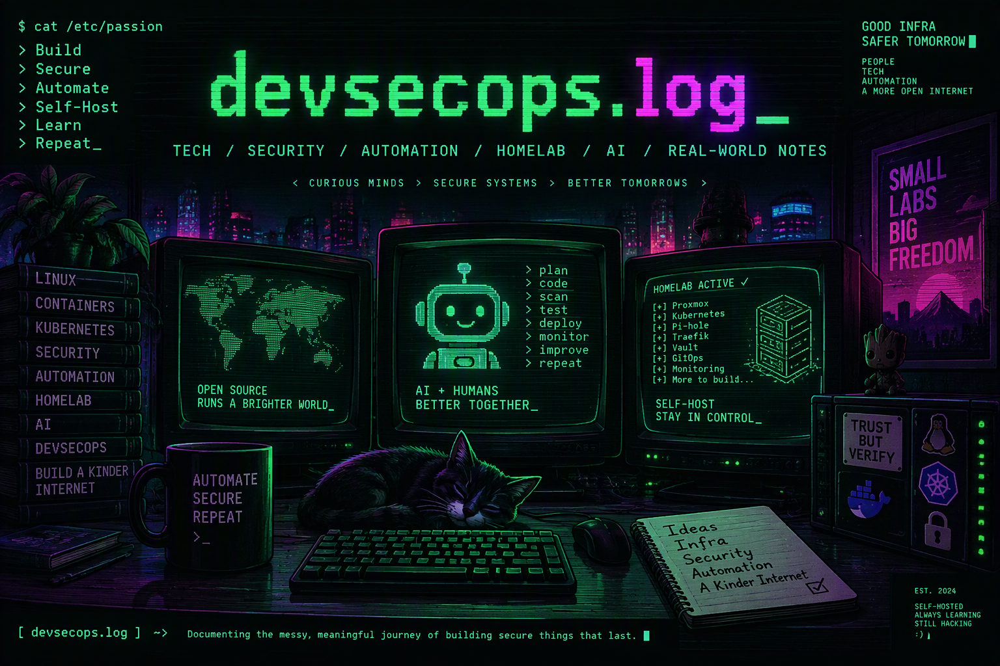

# devsecops.log

A personal tech blog built from markdown posts. Flask is used for development and Frozen-Flask builds a static site for Cloudflare Pages. It has a dark/light theme (dark by default), an about page, client-side search and a mobile-friendly layout.

## Quick start

```powershell
python -m venv .venv
.\.venv\Scripts\Activate.ps1
pip install -r requirements.txt
python app.py        # dev server at http://127.0.0.1:5001
python build.py      # static site in build/
```

Add a post by creating a markdown file in `content/posts/`.

## Documentation
- [Documentation index](documentation/README.md)
- [Architecture](documentation/architecture.md)
- [Writing content](documentation/content-authoring.md)
- [Search](documentation/search.md)
- [Theming and mobile](documentation/theming.md)
- [Deploying to Cloudflare Pages](documentation/deployment-cloudflare.md)
- [Project memory](project-memory/README.md) (plan, decisions, to-do)
