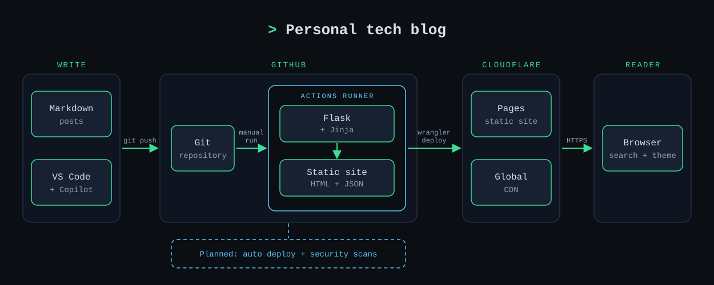

# Why This Blog Exists

I wanted a place to write, share my thoughts on technology, and document some of the projects I build outside of work. After spending many years in the industry, I've accumulated plenty of ideas, lessons learned, and the occasional opinion worth writing down.

I'm also one of those people who genuinely enjoys writing documentation. Yes, I know that's not entirely normal.

I've built this blog using **GitHub**, **GitHub Copilot**, and **Cloudflare** to create a modern, lightweight site that uses Markdown as the primary way I publish content.

## The Setup

- Posts are simple Markdown files with a small amount of YAML front matter.
- The site is generated as static HTML and hosted on Cloudflare Pages.
- Search runs entirely in the browser using a JSON index.

## Why Markdown?

Markdown keeps the writing process simple and friction-free. A new post is just a single file:

```markdown
---
title: My New Post
date: 2026-10-23
tags: [example]
---

Write here.
```

The architecture for the site is shown below.



This project actually started with a single prompt to GitHub Copilot, using **Plan Mode**. Yes, Plan Mode is your friend.

> I would like to build a simple tech blog site for my own personal blog posts. It should use Markdown and have a modern feel with a tech-focused edge. It should include an About Me page and the ability to search through blog posts.

In roughly an hour, Copilot had produced the foundation of the site you're reading today.

At the moment, I've configured a basic GitHub Actions workflow that allows me to deploy the site manually when I choose. However, as a DevSecOps engineer, manual processes aren't nearly as much fun. The next stage is automating the build and deployment pipeline, integrating security tooling, and triggering deployments automatically when changes are pushed to the main branch.

## What You'll Find Here

This blog will be a collection of technical thoughts, industry observations, lessons learned, and the projects I'm currently experimenting with.

I'll aim to post monthly, although life has a habit of getting in the way. Between a full-time job and a very active teenager who lives and breathes cricket, you'll often find me helping out at our local cricket club. Go Brumbies.

I've also got a number of homelab projects underway, including:

- Mini AI Rack Project
- Homelab Redesign (Hardware & Software)
- Ansible Automation and Infrastructure as Code

A quick warning: I'm a huge fan of automation. Ansible has become something of a personal obsession over the years and remains one of my favourite tools both at home and at work.

If something here turns out to be useful to you, fantastic.

If not, it'll at least be useful to future me.