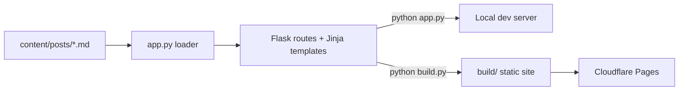

# Architecture

Cloudflare Pages serves static files only. Flask is used for local development and as the templating engine; Frozen-Flask renders every route to HTML at build time.



## Layout

```text
tech-blog-personal/
  app.py                  Flask app, markdown loader, routes
  build.py                Freezes the site into build/
  requirements.txt
  content/
    about.md              About page
    posts/                One markdown file per post
  templates/              Jinja templates (base, index, blog, post, tag, about, search, 404)
  static/
    css/styles.css        Layout and theme variables
    css/pygments.css      Generated code-highlight styles
    js/site.js            Theme toggle and mobile menu
    js/search.js          Client-side search
  scripts/
    generate_pygments_css.py
  documentation/
  project-memory/
```

## Content pipeline
1. `load_posts()` reads `content/posts/*.md`, splits the YAML front matter from the body and renders the body with the `extra`, `fenced_code`, `codehilite`, `toc` and `sane_lists` extensions.
2. Posts with `draft: true` are skipped. The rest are sorted newest first.
3. Results are cached in memory and rebuilt when any file name or modification time changes, so edits show up on refresh during development.
4. Each post gets a reading time (about 200 words per minute) and a plain-text copy used for search.

## Routes

| URL | Purpose |
| --- | --- |
| `/` | Hero and latest posts |
| `/blog/` | All posts and tag list |
| `/blog/<slug>/` | One post; the slug is the markdown file name without `.md` |
| `/tags/<slug>/` | Posts for one tag |
| `/about/` | Renders `content/about.md` |
| `/search/` | Search page (see [search.md](search.md)) |
| `/search-index.json` | Search data generated at build time |
| `/sitemap.xml` | Sitemap, uses the `SITE_URL` environment variable |
| `/404.html` | Not-found page used by Cloudflare Pages |

## Static build
`build.py` configures Frozen-Flask with `build/` as the destination and registers generators for the `post` and `tag` routes (the generator function names must match the endpoint names). After freezing it writes `build/_headers`. Directory-style URLs (`/blog/` becomes `blog/index.html`) work on Cloudflare Pages without extra configuration.

## Site settings
The site name, tagline and base URL live in the `SITE` dictionary at the top of `app.py`. The base URL comes from the `SITE_URL` environment variable and is only used in the sitemap.
